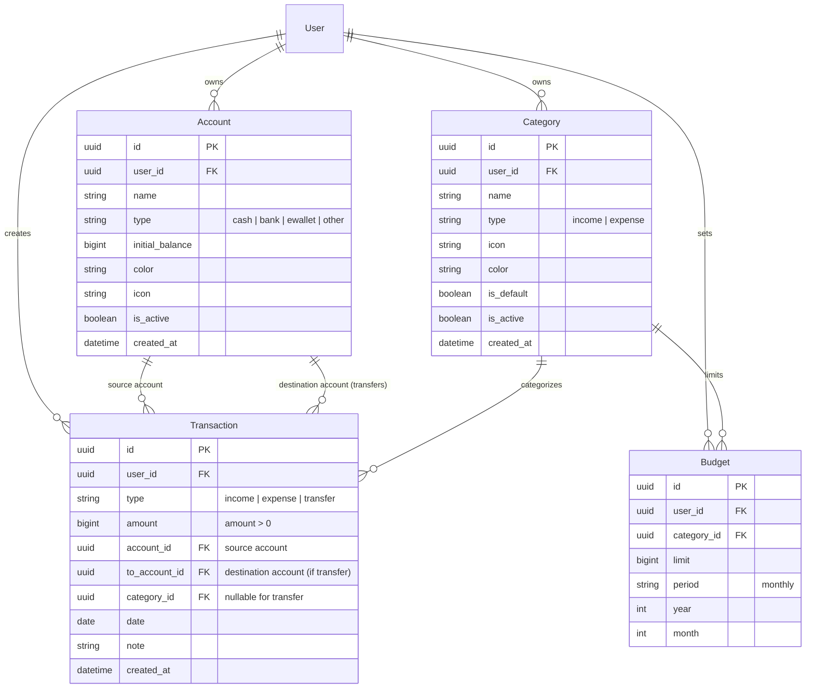

# Design Document: Personal Finance Management System

**Author:** Antigravity Assistant & Eric Border  
**Date:** 2026-11-04  
**Status:** Under Review (Builder Checked)  
**Target Platform:** Web (React 19 + Vite + Tailwind CSS / Django 5.2 + DRF + PostgreSQL 16)

---

## 1. Intent & The "Why"

Managing personal finances is often fragmented across multiple banking apps, e-wallets (Momo, ZaloPay), and cash in hand. Users need a single, private, and intuitive financial cockpit to:
1. Know exactly how much money they have right now across all their cash, bank accounts, and e-wallets.
2. Track daily incomes, expenses, and internal transfers easily with sub-second responsiveness.
3. Keep budgets per expense category and receive visual alerts before overspending (e.g., at 80% and 100% of limits).
4. Visualize spending trends and monthly net savings through interactive dashboards and reports.

---

## 2. Goals, Non-Goals, and Anti-Goals

### Goals
- **Strict Data Isolation (Multi-tenant):** Every user's accounts, categories, transactions, and budgets are fully isolated by `user_id`.
- **Multiple Accounts Management:** Support different account types (`cash`, `bank`, `ewallet`, `other`) with customized icons/colors.
- **Dynamic Category Management:** Support user-created and default-seeded income/expense categories. Implement soft-deletion (`is_active = False`) so historical reports retain original category labels.
- **Single-Source-of-Truth Balance Calculation:** Current balance is dynamically computed:
  $$\text{Balance} = \text{Initial Balance} + \sum \text{Income} - \sum \text{Expense} + \sum \text{Transfers In} - \sum \text{Transfers Out}$$
- **Atomic Internal Transfer:** Transferring money between Account A and Account B is represented as a single `Transaction` with `type="transfer"`, `account=A`, `to_account=B`. Transfers **do not** affect monthly Income or Expense statistics.
- **Category Budgets:** Monthly budget limits per category with spent amount, remaining amount, and progress percentages (80% warning, 100% limit reached).
- **Comprehensive Dashboard:** Matching the ASCII wireframe: summary cards (Total Net Worth, Monthly Income, Monthly Expense, Monthly Savings), Income vs Expense chart, Spending by Category donut/pie chart, Recent Transactions table, and Budget Progress bars.

### Non-Goals (Phase 1)
- Automatic bank syncing / scraping via Open Banking APIs (all inputs are user-entered or CSV).
- Multi-currency conversion (Phase 1 is strictly VNĐ).
- Shared accounts / family budgeting (strictly personal per user).
- OCR receipt scanning (deferred to future feature).
- Savings Goals (F08) and Recurring Auto-Transactions (F09) deferred to Phase 2 to ensure rock-solid core accounting first.

### Anti-Goals
- **No Stale Mutable Balance Fields:** Never update a static balance column without reconciling from transaction history.
- **No Data Loss on Category Deletion:** Never cascade-delete transactions when a category is deleted.
- **No Transfer Contamination:** Never allow internal transfers to inflate the user's monthly income or expense totals in reports.

---

## 3. Approaches Considered & Trade-offs

| Approach | Architecture | Pros | Cons | Decision |
| :--- | :--- | :--- | :--- | :--- |
| **Approach 1: Clean Rebuild** | Drop existing models/migrations, start fresh Django app. | Clean slate. | Destroys existing Auth, CSRF session handling, and 42 passing tests. | **Rejected** |
| **Approach 2: Incremental Refactor (Chosen)** | Keep `accounts` app (Session Auth, Email verification); evolve `finance` models (`Account`, `Category`, `Transaction`, `Budget`) with smooth migrations. | Reuses stable auth, zero disruption, leverages existing Postgres & Vite docker stack. | Requires careful migration from string category to `Category` FK. | **Accepted (User Approved)** |

---

## 4. User-Decided Decisions

1. **Transfer Representation:** A single `Transaction` model record with `type="transfer"`, linking source `account` and destination `to_account`.
2. **Balance Calculation:** Computed dynamically using ledger aggregation (`initial_balance` + net transactions).
3. **Category Deletion:** Soft-delete (`is_active = False`) so existing transactions and past monthly reports remain intact.
4. **Scope Phasing:** Phase 1 implements F01 through F07. F08 (Savings goals) and F09 (Recurring transactions) deferred to Phase 2.

---

## 5. Domain Models & Schema Design (PostgreSQL)

### Constraints & Indexes
- `Transaction`: `CheckConstraint(amount > 0)`.
- `Transaction`: Index on `(user, date)`, Index on `(account, date)`.
- `Transaction`: Check condition that if `type == 'transfer'`, `to_account` is required and `to_account != account`.
- `Budget`: `UniqueConstraint(user, category, year, month)`.
- `Category`: `UniqueConstraint(user, name, type)`.

---

## 6. REST API Specification

### Authentication & User (Inherited from `accounts`)
- `POST /api/auth/login/`, `POST /api/auth/logout/`, `GET /api/auth/me/`, `GET /api/auth/csrf/`

### Accounts (`/api/finance/accounts/`)
- `GET /api/finance/accounts/` — List all active accounts with `initial_balance` and computed `current_balance`.
- `POST /api/finance/accounts/` — Create new account (`name`, `type`, `initial_balance`, `color`, `icon`).
- `PUT/PATCH /api/finance/accounts/{id}/` — Update account details.
- `DELETE /api/finance/accounts/{id}/` — Soft-delete account (`is_active = False`).

### Categories (`/api/finance/categories/`)
- `GET /api/finance/categories/?type=income|expense` — List active categories.
- `POST /api/finance/categories/` — Create custom category.
- `PUT/PATCH /api/finance/categories/{id}/` — Update category.
- `DELETE /api/finance/categories/{id}/` — Soft-delete (`is_active = False`).

### Transactions (`/api/finance/transactions/`)
- `GET /api/finance/transactions/?page=1&limit=20&type=&category=&account=&start_date=&end_date=&search=` — Paginated transaction list.
- `POST /api/finance/transactions/` — Create transaction:
  - If `income`/`expense`: requires `amount`, `account`, `category`, `date`, `note`.
  - If `transfer`: requires `amount`, `account` (from), `to_account` (to), `date`, `note` (category null).
- `GET/PUT/PATCH/DELETE /api/finance/transactions/{id}/` — Retrieve, update, or delete transaction.

### Budgets (`/api/finance/budgets/`)
- `GET /api/finance/budgets/?month=11&year=2026` — List budgets with `spent_amount`, `remaining_amount`, `percentage_used`.
- `POST /api/finance/budgets/` — Set or update monthly budget for a category.
- `DELETE /api/finance/budgets/{id}/` — Delete budget.

### Dashboard & Analytics (`/api/finance/dashboard/`)
- `GET /api/finance/dashboard/?month=11&year=2026` — Aggregated snapshot:
  - `total_balance`: Sum of all active accounts' current balance.
  - `monthly_income`: Total income in the month (excluding transfers).
  - `monthly_expense`: Total expense in the month (excluding transfers).
  - `monthly_savings`: `monthly_income - monthly_expense`.
  - `recent_transactions`: Top 5-10 recent transactions.
  - `category_expenses`: Spending breakdown by category `{ category_name, amount, color, percentage }`.
  - `budget_progress`: List of category budgets with spent vs limit.

---

## 7. Frontend UI / UX Architecture

### Design Guidelines (Powered by `ui-ux-pro-max`)
- **Theme:** Clean, modern Swiss-style financial interface (Tailwind CSS, dark mode support via `.dark` class).
- **Palette:** Trust & Authority:
  - Slate Background: `#0F172A` (Dark), `#F8FAFC` (Light).
  - Brand Primary: `#2563EB` (Royal Blue) / `#059669` (Emerald for Income).
  - Expense / Danger: `#EF4444` (Rose Red).
  - Warning / Budget Alert: `#F59E0B` (Amber).
- **Layout:**
  - Responsive App Shell: Collapsible Sidebar + Sticky Header (User Profile, Notifications, Dark Mode Toggle, Quick "+ Giao dịch" button) + Main Content Area.
- **Pages:**
  1. **Dashboard (`/`):** Summary cards, Charts (Chart.js / Recharts), Budget alerts, Recent transactions.
  2. **Giao dịch (`/transactions`):** Full data table, multi-filter (date range, type, category, account), search bar, Quick add/edit modal.
  3. **Tài khoản ví (`/accounts`):** Grid card view of cash/banks/wallets with balances, transfer action button.
  4. **Danh mục (`/categories`):** Tabbed Income & Expense category manager with icon & color pickers.
  5. **Ngân sách (`/budgets`):** Monthly budget status cards with progress bars and color-coded alerts (green < 80%, yellow 80-99%, red ≥ 100%).
  6. **Báo cáo (`/reports`):** In-depth monthly / yearly cash flow breakdown and category distribution.

---

## 8. Builder Calls (Decisions Delegated to Implementation)
1. **Default Category Seeding:** A post-migration signal or registration hook will auto-seed standard Vietnamese personal finance categories (Lương, Thưởng, Tiền lãi; Ăn uống, Đi lại, Nhà ở, Mua sắm, Hoá đơn, Sức khỏe, Giải trí) for every new user.
2. **Query Performance:** Account balance aggregation and dashboard metrics will use single-query SQL aggregation (`filter=Q(...)` in Django ORM) to keep response times under 50ms.
3. **Frontend Routing:** React Router v7 / v6 routes mapped cleanly to page components with persistent sidebar layout.
